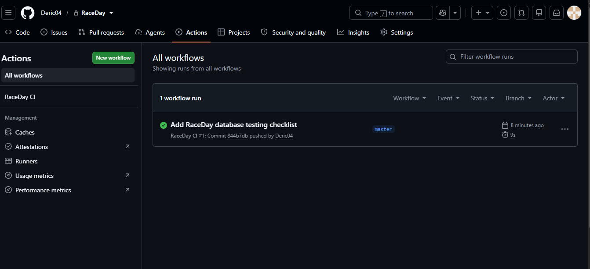

# RaceDay

## 1. System Description

RaceDay is a race event management system designed to help organisers create and manage running events while allowing participants to view available races and enter events.

The system uses a RESTful API, ASP.NET Core, Entity Framework Core and Microsoft SQL Server. Swagger is used to document and test the API, while GitHub Actions automatically builds the project and runs unit tests.

## 2. User Roles and Permissions

### Organiser

Organisers manage race events. Authenticated Organiser accounts can:

- View available events and event details.
- Create race events.
- Update existing race events.
- Delete race events.

Organiser-only operations require authentication and the Organiser role.

### Participant

Participants use the system to access race information. Participants can:

- Register an account.
- Log in securely.
- View available events.
- View individual event details.

Participant accounts cannot perform Organiser-only event management operations.

## 3. Technologies Used

- **C#:** Main programming language.
- **ASP.NET Core Web API:** Provides the REST API.
- **Entity Framework Core:** Handles database access.
- **Microsoft SQL Server:** Stores application data.
- **JWT authentication:** Secures authenticated API requests.
- **Swagger:** Documents and tests API endpoints.
- **xUnit:** Used for automated unit tests.
- **GitHub Actions:** Automates the build and test process.

## 4. Database Design

The RaceDay database design includes seven entities:

- Organisers
- Participants
- Venues
- Events
- Categories
- EventCategories
- Enrolments

The database design uses primary keys, foreign keys, constraints and relationships to maintain data integrity. The EventCategories entity supports the many-to-many relationship between events and categories, while Enrolments records participant entries into event categories.

The database documentation and SQL script are available here:

- [Entity Relationship Diagram and database design](docs/ERD.md)
- [SQL database script](docs/RaceDay.sql)
- [API Endpoint Plan](docs/API-Endpoint-Plan.md)

## 5. Authentication and Security

The API supports account registration and login. Passwords are hashed rather than stored as plain text, and successful login generates a JSON Web Token (JWT).

Protected endpoints require a valid authentication token. Role-based authorisation restricts event creation, updating and deletion to Organiser accounts.

JWT signing keys and other sensitive configuration values must be supplied through local user secrets or suitable environment variables. Real credentials and signing keys must not be committed to the public repository.

## 6. API Endpoints

The implemented event endpoints include:

| Method | Endpoint | Access |
|---|---|---|
| GET | `/api/events` | Public |
| GET | `/api/events/{id}` | Public |
| POST | `/api/events` | Organiser |
| PUT | `/api/events/{id}` | Organiser |
| DELETE | `/api/events/{id}` | Organiser |

The authentication endpoints support participant registration and login. Consult the API Endpoint Plan and Swagger documentation for the available routes and request formats.

## 7. Requirements

Before running the project, install:

- .NET 10 SDK
- Visual Studio 2022 or a compatible development environment
- Microsoft SQL Server and SQL Server Management Studio
- Git

## 8. Setup and Running Instructions

1. Clone or download the RaceDay repository from GitHub:

   `https://github.com/Deric04/RaceDay`

2. Open the solution or project files in Visual Studio 2022.

3. Confirm that SQL Server is running and that the `RaceDay` database is available. Configure the database connection string in the appropriate local configuration.

4. Configure the JWT settings using local user secrets or environment variables. Do not add production signing keys to `appsettings.json` or commit them to GitHub.

5. Open a terminal in the project folder and restore the dependencies:

   ```powershell
   dotnet restore RaceDay.Tests/RaceDay.Tests.csproj
   ```

6. Build the API:

   ```powershell
   dotnet build RaceDay.Api/RaceDay.Api.csproj
   ```

7. Run the API from Visual Studio or by using:

   ```powershell
   dotnet run --project RaceDay.Api/RaceDay.Api.csproj
   ```

8. Open the Swagger URL shown in the terminal or browser launch settings to explore and test the API endpoints.

## 9. Testing

Automated tests are located in `RaceDay.Tests`. They test API behaviour, including access restrictions for different user roles.

To run the tests locally, use:

```powershell
dotnet test RaceDay.Tests/RaceDay.Tests.csproj
```

The expected result is that all four automated tests pass.

API access checks should also confirm that unauthenticated requests to protected endpoints are rejected, Participant requests to Organiser-only endpoints are forbidden, and authorised Organiser requests can create events.

## 10. GitHub Actions CI/CD

GitHub Actions automatically checks the project documentation, restores dependencies, builds the API and test projects, and runs the automated tests when changes are pushed or a pull request is opened.

### Successful CI Build

The screenshot below provides evidence of a successful GitHub Actions workflow.



Additional testing evidence is stored in `docs/images`, including the successful test run and screenshots showing authentication and role-based access results.

## 11. Video Demonstration

The video demonstration will explain the system, database design, API endpoints, authentication, role-based access, Swagger testing, automated unit tests and GitHub Actions workflow.

**Unlisted YouTube video:** Replace this line with the actual unlisted YouTube URL before submitting the assignment.

## 12. Repository

GitHub repository: https://github.com/Deric04/RaceDay
